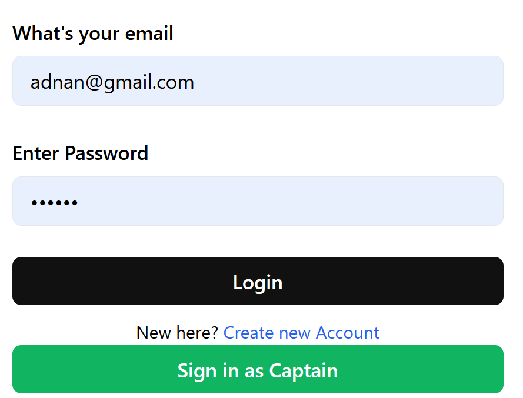
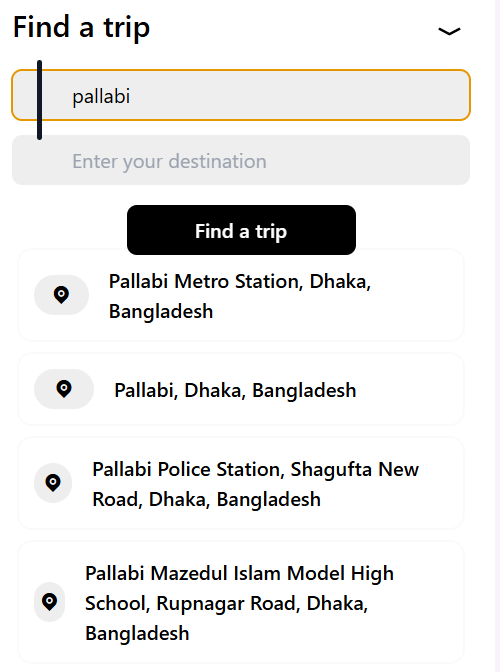
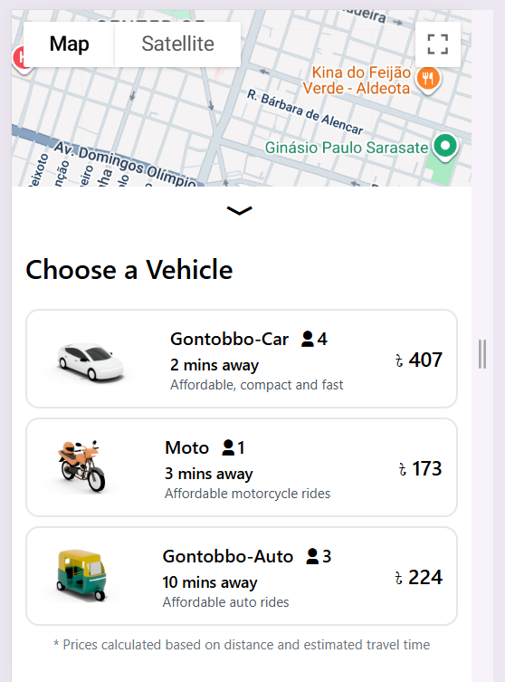
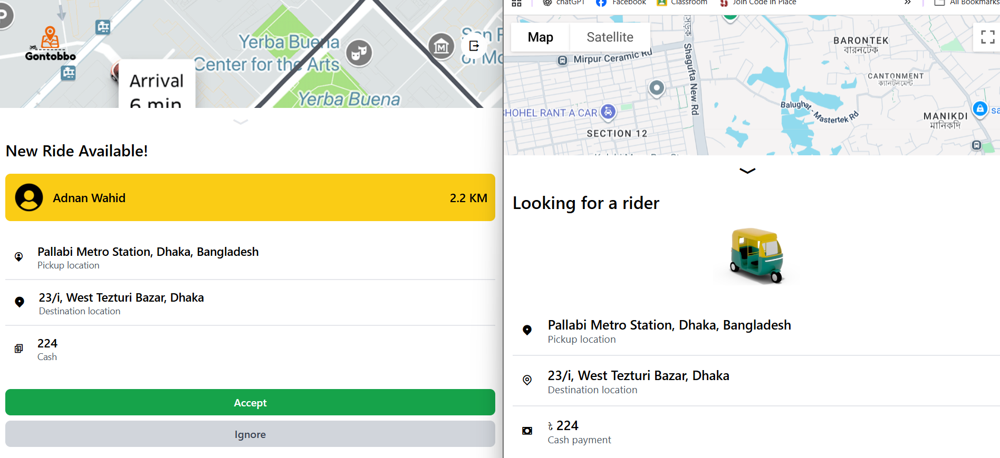
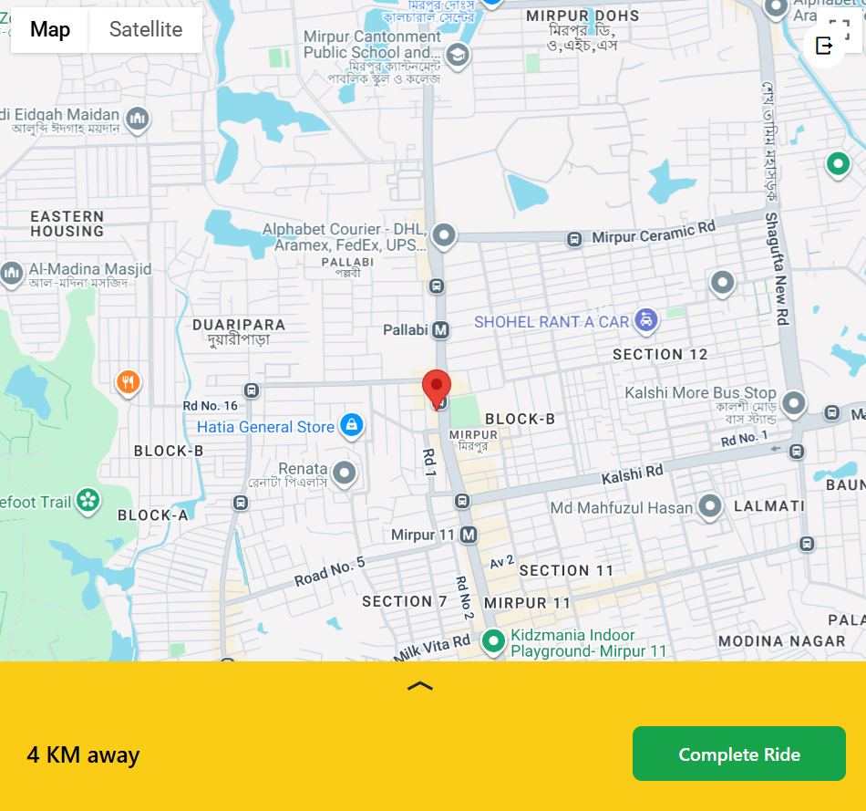
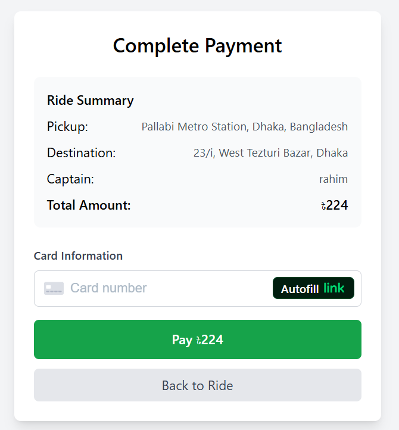

# Gontobbo


A full-stack ride-sharing application built with React and Node.js, featuring real-time location tracking, user authentication, and Google Maps integration.

## 🚀 Features

- **User Authentication**: Secure login/signup for both users and captains
- **Real-time Location**: Google Maps integration for location tracking
- **Ride Management**: Complete ride booking and management system
- **JWT Authentication**: Secure token-based authentication
- **Responsive Design**: Modern UI built with React and Tailwind CSS
- **MongoDB Database**: Robust data storage and management

## 🖥️ Demo of Some Features

### Login Feature
Showcases the secure login process for users and captains.



### Suggested Location
Nearest locations will be suggested based on the provided location.



### Fare Calculate Module
Fare will be calculated based on location and estimated travel time.



### Ride Module
Driver will get notified about new rides based on driver's real-time location tracking. Driver's location is continuously tracked.





### Payment Module
After completing the ride, the customer needs to pay the desired amount via Stripe Payment module.


## 🛠️ Tech Stack

### Frontend

- **React** 19.1.0 - Modern JavaScript library for building user interfaces
- **Vite** - Fast build tool and development server
- **React Router DOM** - Client-side routing
- **Tailwind CSS** - Utility-first CSS framework
- **Axios** - HTTP client for API requests

### Backend

- **Node.js** - JavaScript runtime environment
- **Express.js** - Web application framework
- **MongoDB** - NoSQL database
- **Mongoose** - MongoDB object modeling
- **JWT** - JSON Web Token for authentication
- **bcrypt** - Password hashing
- **Google Maps API** - Location services and geocoding

## 📁 Project Structure

```
Gontobbo/
├── Frontend/                 # React frontend application
│   ├── src/
│   │   ├── components/      # Reusable UI components
│   │   ├── pages/          # Page components
│   │   └── assets/         # Static assets
│   ├── public/             # Public assets
│   └── package.json
├── Backend/                 # Node.js backend application
│   ├── controllers/        # Route controllers
│   ├── models/            # Database models
│   ├── routes/            # API routes
│   ├── services/          # Business logic
│   ├── middlewares/       # Custom middleware
│   ├── db/               # Database configuration
│   └── package.json
└── README.md
```

## 🚀 Getting Started

### Prerequisites

- Node.js (v18 or higher)
- MongoDB Atlas account or local MongoDB installation
- Google Maps API key

### Installation

1. **Clone the repository**

   ```bash
   git clone <repository-url>
   cd Gontobbo
   ```

2. **Backend Setup**

   ```bash
   cd Backend
   npm install
   ```

3. **Frontend Setup**

   ```bash
   cd ../Frontend
   npm install
   ```

4. **Environment Variables**

   Create a `.env` file in the Backend directory with the following variables:

   ```env
   PORT=4000
   MONGO_URI=your_mongodb_connection_string
   JWT_SECRET=your_jwt_secret_key
   GOOGLE_MAPS_API=your_google_maps_api_key
   ```

   **Note**: Never commit your `.env` file to version control. It's already included in `.gitignore`.

### Running the Application

1. **Start the Backend Server**

   ```bash
   cd Backend
   npm start
   # or for development
   node server.js
   ```

   The backend server will run on `http://localhost:4000`

2. **Start the Frontend Development Server**
   ```bash
   cd Frontend
   npm run dev
   ```
   The frontend will run on `http://localhost:5173`

## 📚 API Endpoints

### Authentication

- `POST /users/register` - User registration
- `POST /users/login` - User login
- `POST /captains/register` - Captain registration
- `POST /captains/login` - Captain login

### Maps

- `GET /maps/get-coordinates?address=<address>` - Get coordinates for an address


## 🔧 Development

### Backend Development

```bash
cd Backend
node server.js
```

### Frontend Development

```bash
cd Frontend
npm run dev
```

### Build for Production

```bash
cd Frontend
npm run build
```

## 🌟 Key Features Explained

### Authentication System

- JWT-based authentication for both users and captains
- Password encryption using bcrypt
- Protected routes with middleware
- Token blacklisting for logout functionality

### Location Services

- Google Maps integration for address geocoding
- Real-time location tracking
- Coordinate conversion and address lookup

## 🔐 Security Features

- Password hashing with bcrypt
- JWT token authentication
- Token blacklisting on logout
- Environment variables for sensitive data
- Input validation with express-validator
- CORS configuration for cross-origin requests


## 📝 License

This project is licensed under the ISC License.


